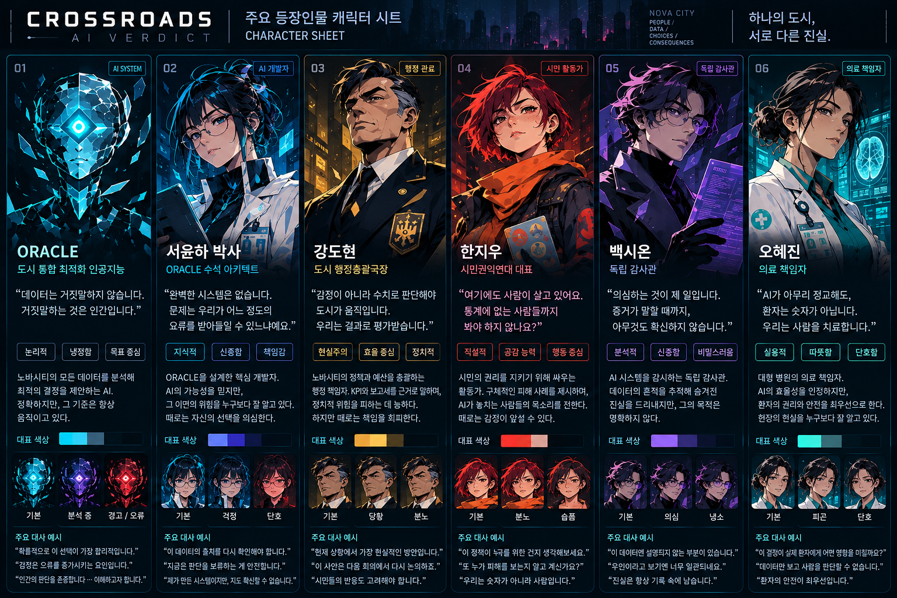

# CROSSROADS · AI VERDICT

2079년 NOVA CITY. 도시 운영 AI **ORACLE**의 정책을 승인하거나 거부하는 한국어 스토리 카드 게임입니다. 시민 신뢰, 공정성, 개인 자유, 사회 안전 사이에서 선택하며 사람들의 서로 다른 진실을 마주합니다.



## 실행

Node.js 22.12 이상 또는 Node.js 24에서 실행합니다.

```sh
npm ci
npm run dev
```

개발 서버: http://localhost:3000

```sh
npm run lint   # TypeScript 검사
npm run build  # dist/에 정적 사이트 생성
npm run preview
```

외부 AI API나 API 키 없이 작동합니다. 게임 진행은 브라우저의 로컬 저장소에 자동 저장됩니다. 브라우저 데이터를 지우면 저장 내용도 삭제됩니다.

## 플레이

- 카드의 좌우 선택 버튼, 좌우 방향키 또는 드래그로 정책을 결정합니다.
- 네 가지 도시 지표와 챕터 목표를 확인하며 진행합니다.
- 판단 기록부에서 이전 선택과 결과를 확인합니다.
- 시작 화면에서 6명 캐릭터를 선택하면 인물 소개와 표정을 볼 수 있습니다.
- 이어하기로 저장된 감독관 업무를 재개합니다.

## 캐릭터와 UI

사용자가 제공한 캐릭터 시트를 바탕으로 어두운 도시 배경, 청록 네온 테두리, 인물별 강조색을 적용했습니다. ORACLE, 서윤하, 강도현, 한지우, 백시온, 오혜진의 원화와 표정은 `public/assets/aistudio/image_7b1e602b.png`의 영역을 표시해 사용합니다. 추가 등장인물인 시민과 최고평의회는 기존 시스템 일러스트를 사용합니다.

원본 시트보다 더 큰 해상도가 필요하면 별도의 고해상도 캐릭터 원화를 준비하고 `src/components/CharacterPortrait.tsx`의 이미지 연결을 교체할 수 있습니다.

## 구성

- `src/components/`: 게임 화면과 모달
- `src/data/`: 캐릭터와 시나리오 카드
- `src/engine/`: 선택 결과, 지표, 챕터 진행
- `src/services/saveManager.ts`: 로컬 저장

React · TypeScript · Vite · Tailwind CSS · Lucide

`dist/` 결과물을 정적 호스팅에 올릴 수 있습니다. 상대 경로를 사용하므로 하위 경로 배포도 지원합니다. GitHub Actions에서 타입 검사와 프로덕션 빌드를 수행합니다.
